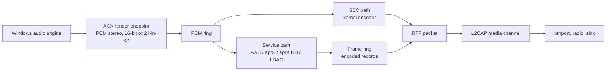

# Overview

[Architecture index](README.md) | [Kernel driver](Driver-Lifecycle.md) | [Encoder service](Encoder-Service.md)

OpenA2DP replaces the A2DP source function driver for the remote sinks the user
switches. It owns codec negotiation, the audio endpoint Windows plays to, the
L2CAP media transport and RTP. The Bluetooth core, radio driver, pairing, HFP and
AVRCP remain with Windows, so a switched sink behaves like any other paired audio
device from the rest of the system's point of view.

## Components

| Component | Runs in | Responsibility |
|---|---|---|
| `OpenA2dp.sys` | kernel, KMDF + ACX | Per-sink A2DP source: binding, AVDTP, L2CAP BRBs, ACX endpoint, kernel SBC encoding, RTP, control device |
| `OpenA2dpSvc.exe` | user mode, LocalSystem | Encodes AAC, aptX, aptX LL, aptX HD and LDAC into the driver's frame ring |
| `OpenA2dpCtl.exe` | user mode, elevated | Command-line status, codec and endpoint settings, driver switching |
| `OpenA2dpConfig.exe` | user mode, elevated | Settings window over the same control device and status report |
| `common/include/OpenA2dp/` | shared headers | Kernel-safe ABI, rings, AVDTP/RTP types, codec selection, latency arithmetic |
| `codecs/` | driver and service | SBC, AAC wrapper, vendored aptX/aptX HD and LDAC encoders, tests |

The driver and service share definitions, not memory ownership. The driver
allocates both rings and maps them into the service; the service never receives a
kernel pointer.

## Audio paths

- **SBC** is encoded in the kernel, integer-only, and is always available.
- **AAC** is encoded by the Windows Media Foundation transform in the service.
- **aptX, aptX HD and LDAC** are encoded by the vendored AOSP encoders in the
  service.
- Every path ends in the driver's RTP builder and one media channel per stream.

The service path adds a frame ring: the service writes encoded records, the
driver validates and sends them one record per packet. [Encoder service](Encoder-Service.md)
covers the boundary; [Protocol and codecs](Protocol-and-Codecs.md) covers packet
formats.

## Control path

Both tools and the service talk to a **control device**, not to the PnP/ACX
device object:

- The PnP object keeps its default security descriptor because the audio engine
  opens it.
- The control device carries a restrictive descriptor (SYSTEM and
  Administrators), its own parallel queue and its own IOCTL surface.
- The service uses it to register encoders, map the rings and wait for stream
  events.
- The tools use it for status, preferences, endpoint formats and version.

A parked `WAIT_EVENT` therefore cannot block a status query. [Encoder service](Encoder-Service.md)
lists the interface; `common/include/OpenA2dp/Ioctl.h` is authoritative.

## Design boundaries

| Boundary | Why it is there |
|---|---|
| Per-sink driver replacement | Different headsets can use different drivers, and a switch is reversible without touching the rest of the machine |
| Kernel SBC, user-mode other codecs | The mandatory codec cannot depend on a service; the user-mode encoders keep Media Foundation and codec code out of the kernel |
| Driver owns transport and session timing | One place decides packet timing, sequence numbers and teardown |
| Service owns encoding and its pacing | Codec start-up cost and Media Foundation live in user mode, where a crash cannot take down the driver |
| One report implementation | The window, **Copy** and the CLI cannot disagree about the session |
| Per-sink INI files | Settings are readable, backupable and survive reboots without a registry schema |

## Failure containment

| Failure | Result |
|---|---|
| Service stops, crashes or hangs | Registration and mapping are cleaned up; media stops; the stream suspends. SBC remains available and the next negotiation falls back |
| Link drops or a send fails | The send completion ends the stream; the endpoint stays usable and a reconnect starts a new session |
| Sink rejects a configuration | The session tries the next scored candidate without reconnecting, then falls back to SBC |
| Driver is disabled, suspended or removed | Teardown is bounded, work items are flushed, late completions close their own channels |
| A tool exits | Its handle cleanup releases the control device; the driver session is unaffected |

## Where the code lives

| Path | Content |
|---|---|
| `driver/Driver.cpp` | Entry point, PnP and device lifecycle |
| `driver/audio/` | ACX endpoint, render clock, PCM copy and format handling |
| `driver/l2cap/` | Channel setup, BRBs, send slots, callbacks |
| `driver/signaling/` | AVDTP session, codec selection, stream transitions |
| `driver/media/` | SBC encoding, service frame drain, RTP send and pacing |
| `driver/service/` | Control device, IOCTLs, rings, service lifetime |
| `driver/config/` | Per-sink settings file |
| `service/main.cpp` | Service host and encoder workers |
| `tools/common/` | Control-device access, status report, sink matching, driver switching |
| `codecs/` | Codec interfaces and encoder implementations |
| `tests/CodecTests/` | Host test suite |
| `tests/HardwareTests/` | Scripted hardware procedures |
