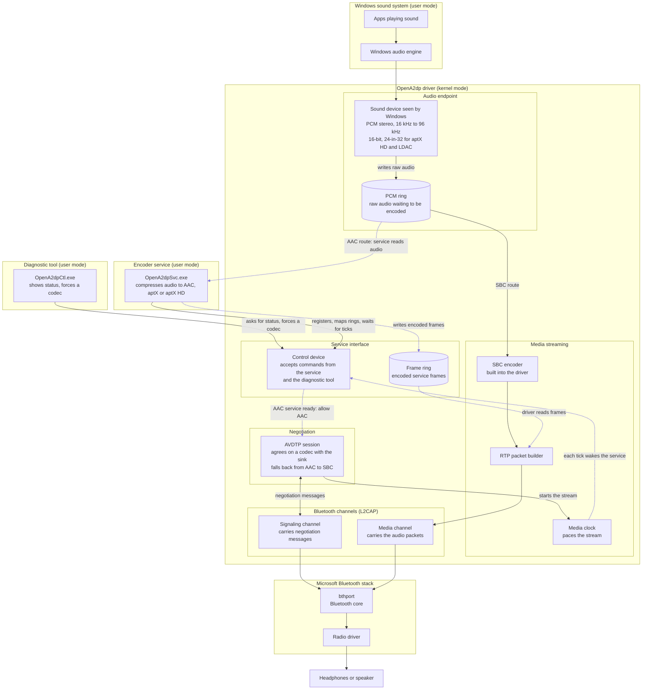

# System architecture

OpenA2dp replaces `BthA2dp.sys` per remote A2DP sink device, not the Bluetooth radio/core stack. Windows 11 x64 only; HFP/HSP and existing AVRCP handling remain with Microsoft. A2DP sink mode and LE Audio are outside scope.

## Components
| Component | Responsibility |
|---|---|
| `OpenA2dp.sys` (KMDF + ACX) | Audio endpoint, AVDTP, L2CAP BRBs, kernel SBC encoding and RTP transport |
| `OpenA2dpSvc.exe` | Windows service with a worker per sink; Media Foundation AAC-LC and the AOSP aptX/aptX HD encoders |
| `common/include/OpenA2dp/` | Kernel-safe ABI, rings, AVDTP/RTP and codec selection; no STL/exceptions |
| `codecs/` | Codec interfaces, SBC/AAC/aptX encoding and negotiation support |
| `OpenA2dpCtl.exe` | Diagnostic device/status/codec-preference CLI |
| `OpenA2dpConfig.exe` | Desktop settings window: sink list, live status and the codec/endpoint preference; see [configuration design](Codec-Configuration.md) |

## Data flow
```text
Windows audio engine -> ACX endpoint -> PCM ring
  SBC: kernel SbcFixed -> RTP -> L2CAP -> bthport -> Bluetooth transport/radio
  AAC: shared PCM ring -> service/MF -> LATM frame ring -> driver RTP -> same transport
  aptX: shared PCM ring -> service/AOSP -> frame ring -> driver RTP -> same transport
```

SBC stays integer-only in the kernel so mandatory audio does not depend on a service. AAC and the aptX codecs use user-mode encoders (Media Foundation and the vendored AOSP trees); the driver validates returned records and owns transport. See [encoder service boundary](Encoder-Service.md) for memory/trust boundaries.

The driver binds above Microsoft's `bthport`/`BthEnum`; `bthusb` or the vendor radio transport remains unchanged. One ACX render circuit represents each remote device. See [driver lifecycle](Driver-Lifecycle.md) for ownership and teardown constraints.


